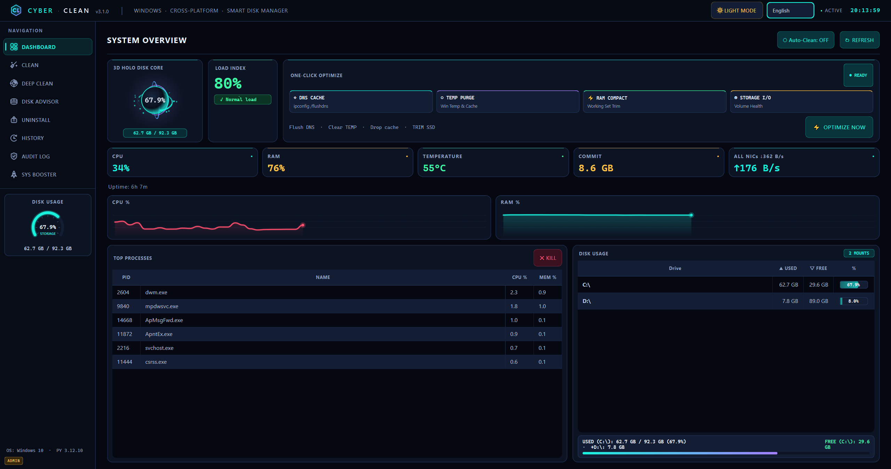
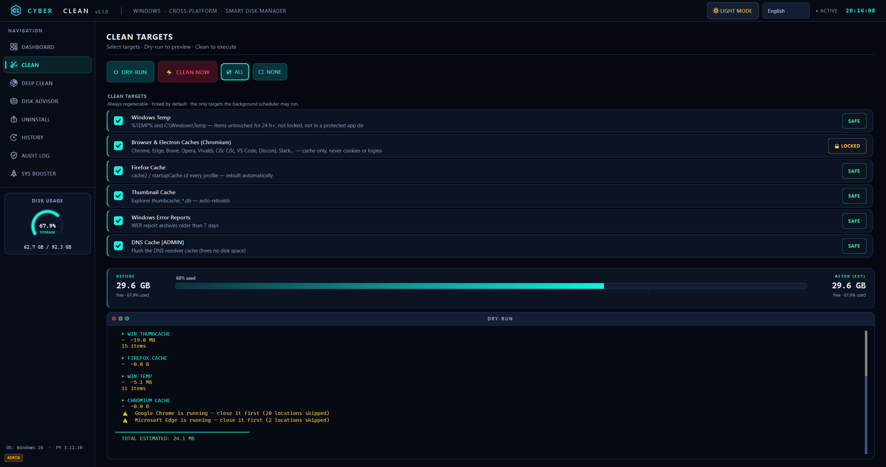
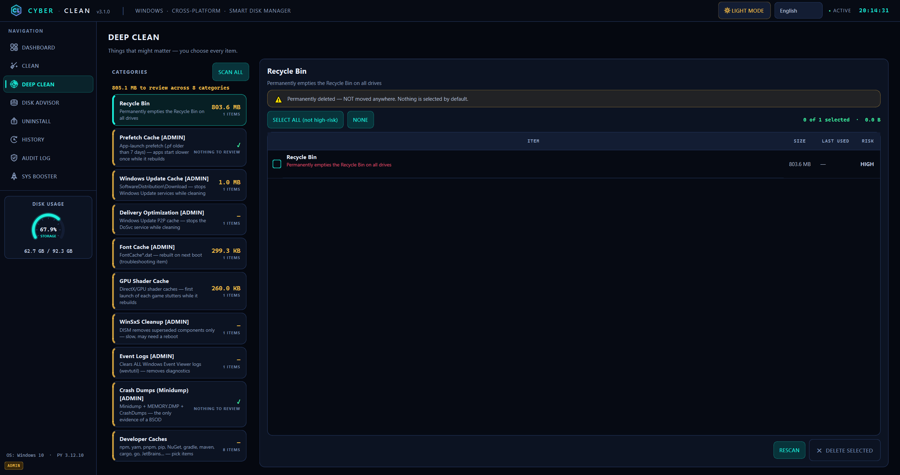
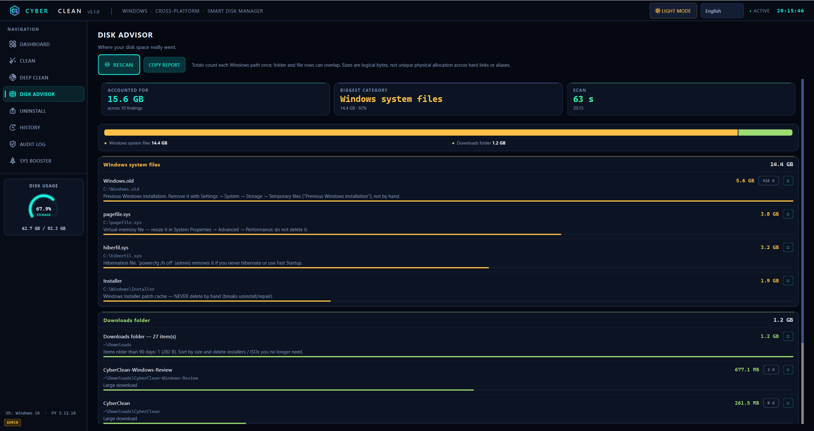
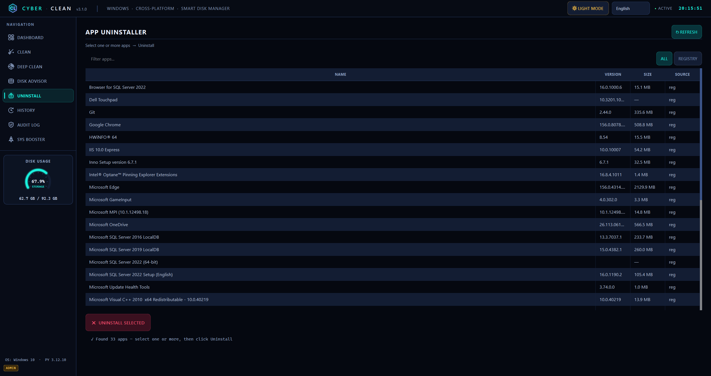
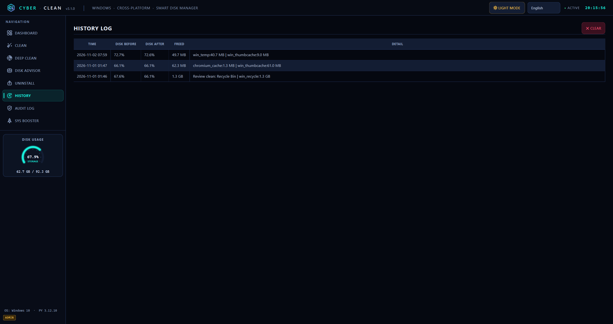
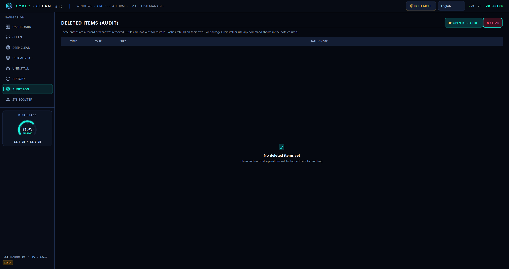
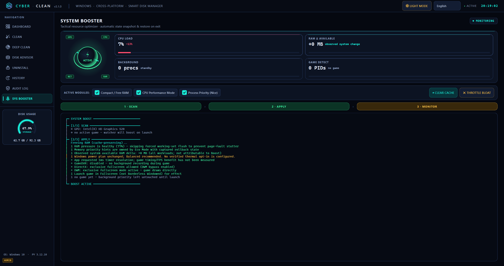

<div align="center">

<!-- Animated Cyber Wave Banner -->


```text
 ██████╗██╗   ██╗██████╗ ███████╗██████╗      ██████╗██╗     ███████╗ █████╗ ███╗   ██╗
██╔════╝╚██╗ ██╔╝██╔══██╗██╔════╝██╔══██╗    ██╔════╝██║     ██╔════╝██╔══██╗████╗  ██║
██║      ╚████╔╝ ██████╔╝█████╗  ██████╔╝    ██║     ██║     █████╗  ███████║██╔██╗ ██║
██║       ╚██╔╝  ██╔══██╗██╔══╝  ██╔══██╗    ██║     ██║     ██╔══╝  ██╔══██║██║╚██╗██║
╚██████╗   ██║   ██████╔╝███████╗██║  ██║    ╚██████╗███████╗███████╗██║  ██║██║ ╚████║
 ╚═════╝   ╚═╝   ╚═════╝ ╚══════╝╚═╝  ╚═╝     ╚═════╝╚══════╝╚══════╝╚═╝  ╚═╝╚═╝  ╚═══╝
```

<!-- Animated Typing SVG (No emojis, pure terminal style) -->
<a href="https://github.com/vuphitung/CyberClean">
  
</a>

**Desktop utility for Windows and Linux: system monitoring, disk cleanup, disk-usage report, app uninstaller and an optional performance booster.**

[](https://python.org)
[](https://pypi.org/project/PyQt6/)
[](#platform-support)
[](LICENSE)
[](https://github.com/vuphitung/CyberClean/releases/latest)
[](CHANGELOG.md)

<br>

<a href="README.md"></a>&nbsp;&nbsp;<a href="README_vi.md"></a>

</div>

## Quick Installation

Choose your platform and follow the steps below.

###  &nbsp;Linux

<p>
  
  
  
  
  
</p>

Install with one command:

```bash
curl -sSL https://raw.githubusercontent.com/vuphitung/CyberClean/main/install.sh | sudo bash
```

Installs to `/opt/CyberClean`, registers the `cyberclean` command, and sets up a scoped privilege helper.

<details>
<summary>Uninstall CyberClean</summary>

```bash
sudo cyberclean --uninstall
```
</details>

---

### 

<p>
  <a href="https://github.com/vuphitung/CyberClean/releases/latest">
    
  </a>
</p>

**[Download CyberClean for Windows (.exe)](https://github.com/vuphitung/CyberClean/releases/latest)**

The UAC prompt appears only during the first installation. Uninstall via **Settings → Apps → CyberClean**.

## Overview

CyberClean shows live system metrics, finds files that can be cleaned, reports where disk space went, uninstalls applications, and can apply a reversible set of performance tweaks while you play or work. It is a PyQt6 application with a dark and a light theme and an English and a Vietnamese interface.

Cleanup targets are files and caches only. CyberClean is not an antivirus and does not clean the registry. Performance results depend on the machine and workload; the app does not promise a speed-up.

## Screenshots

*Windows 10, dark theme.*

**Dashboard** — live metrics, one-click maintenance, top processes, per-volume usage


**Clean** — regenerable caches, dry-run preview, estimated free space


**Deep Clean** — items you choose one by one


**Disk Advisor** — where the space went (report only)


**Uninstaller**


**History** and **Audit log**



**System Booster**



## Features

### Dashboard
- CPU, RAM, temperature (when a sensor is available), commit memory (Windows) or swap (Linux), network throughput, CPU/RAM history graphs and uptime; refreshed every few seconds.
- Top processes with a Kill button, and used/free space for every mounted volume.
- **One-click optimize** — Windows: flush DNS cache, clear temp files, trim working sets, TRIM SSD. Linux: drop caches, tune `vm.swappiness`, `fstrim`, vacuum old journal logs.
- *Load index* is a heuristic built from CPU, RAM, disk, temperature and swap. It is not CPU usage, SMART data or a disk-health diagnosis.

### Clean
Targets that can be regenerated, ticked by default. *Dry-run* shows exactly what would be removed before you run *Clean now*.

| OS | Targets |
|---|---|
| Windows | Windows Temp, Chromium-based browser and Electron app caches (Chrome, Edge, Brave, Opera, Vivaldi, Cốc Cốc, VS Code, Discord, Slack…), Firefox cache, thumbnail cache, Windows Error Reports, DNS cache |
| Linux | Package-manager caches (apt, pacman, dnf, zypper, xbps, apk, rpm-ostree), journal and old system logs, crash reports, browser and Electron caches, thumbnails, pip cache, temp files |

Browser caches are skipped, with a note, while the browser is running.

### Deep Clean
Items that might matter. **Nothing is pre-selected**, "select all" skips high-risk rows, and every delete asks for confirmation (default answer: Cancel). Deep Clean never runs in the background.

- Windows: Recycle Bin, Prefetch, Windows Update cache, Delivery Optimization, font cache, GPU shader cache, WinSxS cleanup, Event Logs, crash dumps, developer caches (npm, yarn, pnpm, pip, NuGet, Gradle, Maven, Cargo, Go, JetBrains…).
- Linux: orphaned/unused packages (apt, pacman, dnf, xbps), Nix garbage collection, developer caches, other `~/.cache` folders, Trash, and — when installed — Docker/Podman, Flatpak unused runtimes, Snap old revisions.

### Disk Advisor
Report only — there is no delete button. Groups the largest consumers: Windows system files (`Windows.old`, `pagefile.sys`, `hiberfil.sys`, Installer cache), Downloads, large files, virtual machines and WSL disks, game libraries, old `node_modules` / `target` / virtualenv folders, containers, `/opt`, heaviest packages. Rows can be opened in the file manager and the report can be copied.

### Uninstaller
- Windows: installed programs from the Registry, enriched with `winget` data.
- Linux: pacman, apt, dnf, zypper, xbps and Flatpak; core system packages are protected.
- Multi-select with live progress log. On Windows the list is not filtered, so check entries (drivers, runtimes) before removing them.

### History and Audit log
*History* records each session's disk usage before/after and the space freed. *Audit log* records what was removed (path, type, size). Both are local files; removed files are not kept for restore.

### System Booster
Applies tweaks on demand and **captures the original state first**. The state is restored when you turn Boost off or close the app, and recovered on the next start if the app was killed.

- Windows: 1 ms timer-resolution request, GameDVR off, DirectX/DWM fullscreen setting, priority for a detected game, background-process throttling (EcoQoS on Windows 11), browser GPU-cache cleanup.
- Linux: CPU governor / power profile, memory tuning, process priority, Hyprland options when it is running.
- A game watcher raises priority only while a game is running. The log states when a benefit has not been measured.

### Tray and Auto-clean
Auto-clean is **off by default**. When enabled it runs only `AUTO` targets flagged as scheduled, only when the machine is idle, at most every 6 hours, and only while the app is open or in the tray. It never touches the Recycle Bin or Trash. If Auto-clean is off, closing the window quits the app.

### Updates and privacy
The app checks GitHub Releases for a new version and installs nothing without your click. Downloads are verified against an Ed25519 signature built into the app. There is no telemetry or analytics; the update check is the only network access.

## How cleaning stays predictable

| Tier | Page | Behaviour |
|---|---|---|
| `AUTO` | Clean | Regenerable caches. Ticked by default. The only tier the scheduler may run. |
| `REVIEW` | Deep Clean | Needs an explicit choice for every item. |
| `ADVISOR` | Disk Advisor | Report only. |

A clean is **planned, previewed, then executed**. Immediately before each deletion the engine re-checks the item and skips it if it changed since the scan, is in use, or its owning app started again. Symlinks and junctions are not followed and mount points are not crossed. **Deletion is permanent** — nothing is moved to the Recycle Bin.

## Platform support

| Environment | Status |
|---|---|
| Windows 10 (build 19044), Python 3.12 | Run and used on a real machine: all pages, metric comparison against Windows counters, Windows-specific tests pass. |
| Windows 11 | Code paths exist (for example EcoQoS); not verified on hardware. |
| Linux, apt-based (Ubuntu / Debian family) | Automated tests pass headless on Ubuntu with Python 3.12 (628 passed, 17 skipped). |
| Other Linux distributions | Package-manager detection for pacman, dnf, zypper, xbps, apk, rpm-ostree and Nix; not individually tested. |

CPU temperature on Windows is optional and needs the installed sensor helper (LibreHardwareMonitor + PawnIO); when no sensor is available the dashboard shows `N/A`. Running `main.py` directly from source does not include that helper.

## Installation

**Requirements:** Python 3.10+ (PyQt6, psutil, cryptography, send2trash; `tomli` on Python 3.10; `pythonnet` on Windows). Administrator/root is not needed to open the app; items marked `[ADMIN]` need elevated rights.

### Run from source (Windows and Linux)

```bash
git clone https://github.com/vuphitung/CyberClean.git
cd CyberClean
python -m venv .venv

# Linux
source .venv/bin/activate
# Windows PowerShell
.venv\Scripts\Activate.ps1

python -m pip install -r requirements.txt
python -X utf8 main.py
```

### Linux installer (from a published release)

```bash
curl -sSL https://raw.githubusercontent.com/vuphitung/CyberClean/main/install.sh | sudo bash
```

Verifies the release signature, installs to `/opt/CyberClean`, registers the `cyberclean` command and a desktop entry, and sets up a restricted privilege helper. Uninstall with `sudo cyberclean --uninstall`.

### Windows package

Build it yourself (below). Packaged builds are attached to [GitHub Releases](https://github.com/vuphitung/CyberClean/releases) when a release is published.

## Build

```bash
python -m pip install pyinstaller
python build.py --linux      # Linux tar.gz
python build.py --windows    # Windows onedir folder in dist/CyberClean
python build.py --inno       # Windows onedir + Inno Setup script (compile it with Inno Setup)
```

## Development

```bash
python -m pip install -r requirements-dev.txt
python -m pytest -q
python -m pyflakes main.py ui_widgets.py ui_pages.py core utils
```

On Windows the full suite currently reports 49 failures that come from POSIX-only fixtures (symlinks that need a privilege, Unix sockets, Linux-only targets); the Windows-specific tests pass. Details: [Windows report](docs/WINDOWS_NATIVE_REPORT_VI.md) (Vietnamese). Use a dedicated test folder when you try deletion.

```text
CyberClean/
├── main.py                 # application entry, window and tray
├── ui_widgets.py, ui_pages.py
├── core/                   # engine, cleaners, booster, advisor, uninstaller
├── utils/                  # telemetry, translations, updater
├── rules/                  # per-OS cleanup rules (TOML)
├── packaging/              # Linux privilege helper
├── vendor/lhm/             # Windows sensor library
├── tests/                  # pytest
├── build.py, install.sh
└── assets/, screenshots/
```

## Known limitations

- Interactive testing on real Linux desktops is limited; please report distribution-specific problems.
- Windows 11, ARM64 and other DPI/driver combinations have not been verified.
- Booster effects are not benchmarked by the app.
- Size estimates for logs and WinSxS can differ from the space actually freed (volume, permissions, snapshots).

## Contributing and issues

Open an issue with your OS and version, the CyberClean version, what you did, and the text shown in the app.

## License

GNU General Public License v3.0 — see [LICENSE](LICENSE).


