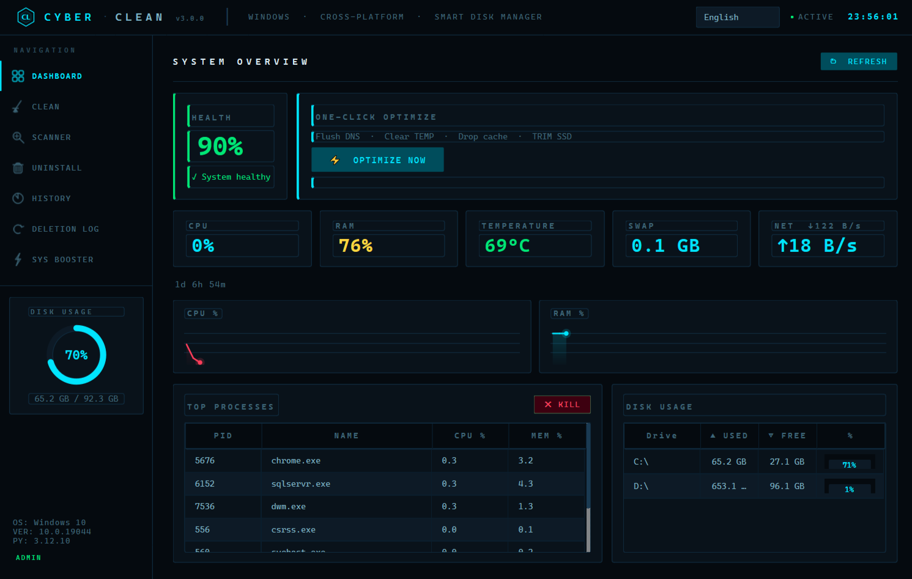
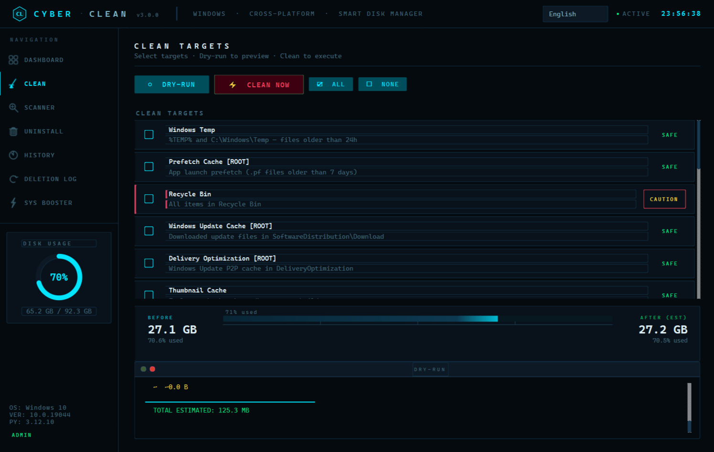
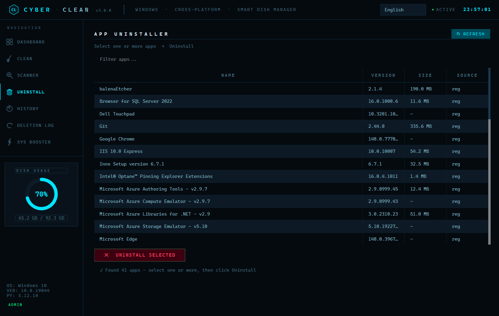
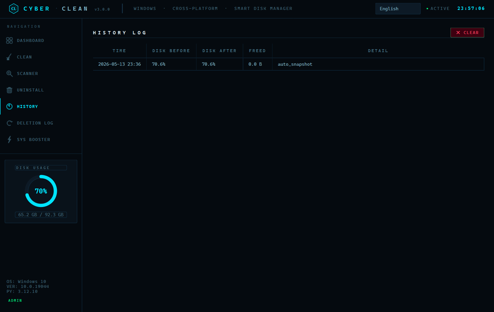
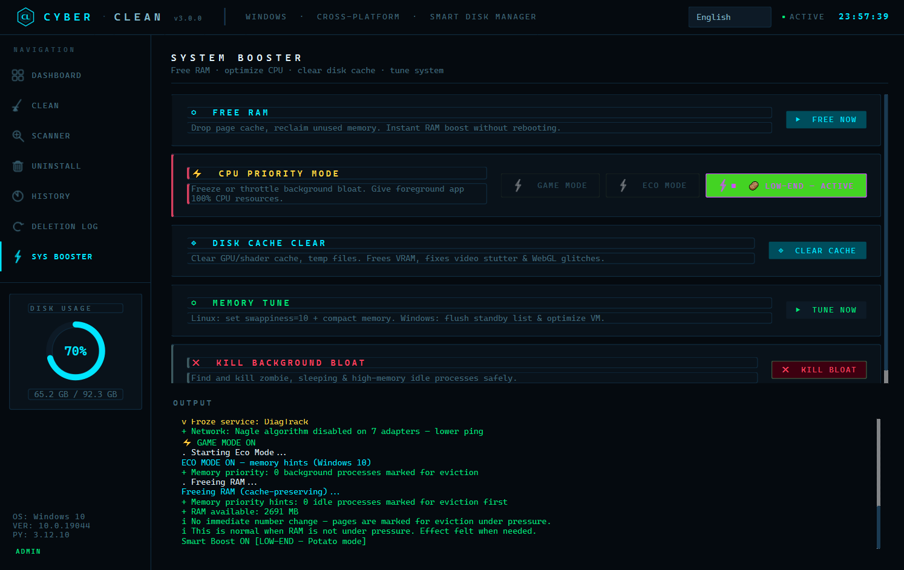

<div align="center">

```
 ██████╗██╗   ██╗██████╗ ███████╗██████╗      ██████╗██╗     ███████╗ █████╗ ███╗   ██╗
██╔════╝╚██╗ ██╔╝██╔══██╗██╔════╝██╔══██╗    ██╔════╝██║     ██╔════╝██╔══██╗████╗  ██║
██║      ╚████╔╝ ██████╔╝█████╗  ██████╔╝    ██║     ██║     █████╗  ███████║██╔██╗ ██║
██║       ╚██╔╝  ██╔══██╗██╔══╝  ██╔══██╗    ██║     ██║     ██╔══╝  ██╔══██║██║╚██╗██║
╚██████╗   ██║   ██████╔╝███████╗██║  ██║    ╚██████╗███████╗███████╗██║  ██║██║ ╚████║
 ╚═════╝   ╚═╝   ╚═════╝ ╚══════╝╚═╝  ╚═╝     ╚═════╝╚══════╝╚══════╝╚═╝  ╚═╝╚═╝  ╚═══╝
```

**Công cụ Dọn dẹp & Tối ưu Hiệu năng Hệ thống**

[](https://python.org)
[](https://pypi.org/project/PyQt6/)
[](https://github.com/vuphitung/CyberClean/releases/latest)
[](LICENSE)
[](https://github.com/vuphitung/CyberClean/releases/latest)

🌐 **Ngôn ngữ / Language:** [English](README.md) · **Tiếng Việt**

</div>

## Cài đặt

### Linux

```bash
curl -sSL https://raw.githubusercontent.com/vuphitung/CyberClean/main/install.sh | sudo bash
```

Cài vào `/opt/CyberClean` · tạo lệnh `cyberclean` · đăng ký app vào launcher · thiết lập helper đặc quyền có phạm vi giới hạn.

**Gỡ cài đặt:**
```bash
sudo cyberclean --uninstall
```

### Windows

**[⬇ Tải CyberClean cho Windows (.exe)](https://github.com/vuphitung/CyberClean/releases/latest)**

Chỉ hỏi UAC một lần lúc cài. Gỡ qua `Cài đặt → Ứng dụng → CyberClean`.

---

## Screenshots

<p align="center">
  
</p>
---

<p align="center">
  
</p>
---

<p align="center">
  
</p>
---

<p align="center">
  
</p>
---

<p align="center">
  
</p>
---

## Tính năng

### [◈] Bảng điều khiển
Thống kê hệ thống thời gian thực, tự làm mới mỗi 4 giây.

- CPU / RAM / Swap / Nhiệt độ / Lưu lượng mạng
- Danh sách tiến trình nặng, tắt ngay một click
- Dung lượng ổ đĩa từng phân vùng
- Thời gian hoạt động

---

### [✦] Dọn dẹp Thông minh — ba tầng, ba trang
CyberClean không đoán xem thứ gì xóa được. Mỗi mục thuộc một trong ba tầng, và mỗi tầng có **trang riêng** trên thanh bên:

| Tầng | Trang | Gồm | Cách hoạt động |
|------|-------|-----|----------------|
| **AUTO** (tự động) | **DỌN RÁC** | Thứ luôn tái tạo được: cache trình duyệt & app Electron, thumbnail, log đã xoay vòng, cache trình quản lý gói, journal, file tạm cũ, crash dump | Tick sẵn · là tầng DUY NHẤT được phép chạy nền khi máy rảnh |
| **REVIEW** (xem lại) | **DỌN SÂU** | Thứ *có thể* quan trọng: gói mồ côi, cache lập trình, image/volume Docker, phần thừa của Flatpak/Snap, thư mục lạ trong `~/.cache`, Thùng rác | Danh mục bên trái, từng mục bên phải — **không mục nào được tick sẵn**, "chọn hết" bỏ qua mục rủi ro cao (lời cảnh báo hiện đầy đủ), mỗi lần xóa đều hỏi lại (mặc định: Hủy) · không bao giờ chạy nền |
| **ADVISOR** (tư vấn) | **TƯ VẤN Ổ ĐĨA** | Dung lượng *thật sự* đi đâu: máy ảo, thư viện game, `/opt`, gói nặng, file lớn, `node_modules`/`target`/venv của dự án cũ, Downloads, ổ WSL | **Chỉ báo cáo** — thẻ tổng quan, thanh tỷ lệ dung lượng, thẻ theo danh mục, "mở thư mục" và "sao chép báo cáo"; không có nút xóa |

Một lần dọn diễn ra thế nào (Linux và Windows dùng chung `core/engine.py`):

1. **Lập plan** — quét một lần ra danh sách mục cụ thể (dung lượng thật, hardlink tính đúng).
2. **Xem trước** — Dry-run hiển thị đúng plan đó.
3. **Thực thi** — chạy *chính plan đó*, nhưng kiểm tra lại từng mục ngay trước khi xóa: bị thay mới? đã sửa kể từ lúc quét? app chủ vừa mở lại? Cái gì đã đổi thì bị bỏ qua, không bao giờ bị xóa.

Các hàng rào áp cho mọi thứ: tuổi (không đụng ≥ N ngày + không bao giờ đụng thứ vừa sửa trong 10 phút) · app sở hữu phải đã tắt (danh sách tiến trình, `SingletonLock` của Chromium, `--user-data-dir`) · file/thư mục không đang được tiến trình nào mở · không bao giờ đi theo symlink/junction · không băng qua mount point · thư mục chứa socket/FIFO (trạng thái runtime đang sống như `/tmp/.X11-unix`, `tmux-*`, `ssh-*`) bị bỏ qua · file của user khác bị bỏ qua.

Dung lượng trống được đo bằng `shutil.disk_usage` trước/sau. Nếu ổ là Btrfs/ZFS, app cảnh báo rằng snapshot có thể vẫn giữ dung lượng — xóa xong chưa chắc giải phóng ngay.

**Linux** — pacman / apt / dnf / zypper / xbps / apk / rpm-ostree (Fedora Atomic, Bazzite) / Nix · cache AUR build · Flatpak (user + system) · Docker/Podman · Snap · journal · trình duyệt (mọi trình duyệt Chromium và app Electron bằng MỘT luật — Chrome, Brave, Edge, Vivaldi, Opera, VS Code, Cursor, Discord, Slack…; Firefox kể cả bản Snap/Flatpak) · pip · thumbnail · file tạm.

**Windows** — Temp, Thumbnail DB, báo cáo WER, DNS flush (auto) · Thùng rác, Prefetch, Windows Update / Delivery Optimization, Font & GPU shader cache, WinSxS, Event log, crash dump (review, mỗi cái một mục phải tick rõ ràng) · cache trình duyệt theo cùng luật Chromium/Firefox · cache lập trình (npm, NuGet, Gradle, Maven, Cargo, Go, JetBrains…).

> **Lưu ý Windows** — các lệnh chỉ có trên Windows (DISM, dịch vụ, `wevtutil`) không đổi và chưa chạy thử được trong môi trường test; engine, tầng, luật và hàng rào đều có unit test.

#### Luật dạng khai báo, không phải code
Các mục dạng đường dẫn nằm trong [`rules/linux.toml`](rules/linux.toml) và [`rules/windows.toml`](rules/windows.toml). Một luật là dữ liệu (`paths`, `mode`, `min_age_days`, `closed`, `keep`, `tier`…) — thêm một app chỉ là PR 6 dòng, dễ review. Luật cá nhân đặt ở `~/.config/cyber-clean/rules.d/*.toml`; chúng bị ép vào tầng **REVIEW**, chỉ được trỏ vào trong thư mục home của bạn và không bao giờ chạy nền.

---

### [⚡] System Booster
Tối ưu hiệu năng không gây crash. Mọi thay đổi đều có thể hoàn tác hoàn toàn.

- **Giải phóng RAM** — nén bộ nhớ không cần dùng mà không ảnh hưởng page cache
- **Memory Tune** — swappiness / vm params (Linux) · trim working set tiến trình nhàn rỗi (Windows)
- **Kill Bloat** — loại bỏ tiến trình zombie và ngốn RAM nhưng không làm gì
- **Xóa GPU / Shader Cache** — mesa, NVIDIA, Chrome, Edge
- **[◈] Game Mode** — CPU jail 3 tầng, dồn toàn bộ tài nguyên cho app foreground
- **[~] Eco Mode** — cgroups v2 (Linux) · EcoQoS + memory priority (Windows 11)
- **[★] Smart Boost** — tự phân loại máy (High / Mid / Low) theo RAM + core + GPU VRAM
- **Tắt TCP Nagle** — giảm ping game online (Windows)
- **Timer Resolution 1ms** — frame mượt hơn (Windows)

---

### [≡] Gỡ cài đặt ứng dụng
- **Windows** — đọc từ registry Add/Remove Programs (không dùng `wmic`)
- **Linux** — tích hợp pacman / apt / dnf
- Hiển thị dung lượng, phiên bản, nguồn cài
- Gỡ nền với log tiến trình trực tiếp

---

### [↺] Lịch sử & Log xóa
- Mỗi phiên dọn dẹp được ghi vào `~/.local/share/cyber-clean/history.jsonl`
- Audit trail đầy đủ: đường dẫn, kích thước, loại của từng file bị xóa
- Xem dung lượng đã giải phóng theo từng phiên

---

### [↑] Tự động cập nhật
Kiểm tra GitHub Releases lúc khởi động (chạy nền, không block UI) — chỉ hiện badge, không tự tải/tự cài nếu chưa bấm. Update cần bấm xác nhận rõ ràng; file tải về được verify bằng chữ ký Ed25519 nhúng sẵn trong app trước khi cài bất cứ thứ gì.

---

### [♪] System Tray & Tự động dọn
Thu nhỏ xuống khay hệ thống. Tự động dọn **chỉ các mục tầng AUTO có cờ `scheduled`** mỗi 6 tiếng khi máy nhàn rỗi (CPU < 20%, mạng < 500 KB/s), với ngưỡng tuổi nghiêm hơn dọn thủ công (ví dụ cache trình duyệt chỉ bị dọn nếu trình duyệt đó không dùng suốt 7 ngày). Không bao giờ đụng Thùng rác, gói mồ côi, cache lập trình, Docker hay bất cứ thứ gì ở tầng REVIEW, không bao giờ hiện hộp thoại mật khẩu, và tự tạm dừng khi Game Mode đang bật.

---

## Tương thích

| Hệ điều hành | Phiên bản | Ghi chú |
|---|---|---|
| Linux | Arch · Manjaro · EndeavourOS · CachyOS | pacman |
| Linux | Ubuntu · Debian · Pop!_OS · Mint · Kali | apt |
| Linux | Fedora · CentOS · Rocky · Nobara | dnf |
| Linux | openSUSE Leap / Tumbleweed | zypper |
| Linux | Void Linux | xbps |
| Linux | Alpine | apk (cài từ mã nguồn) |
| Linux | Fedora Atomic · Silverblue · Kinoite · Bazzite | rpm-ostree |
| Linux | NixOS | nix-collect-garbage (user profile) |
| Linux | Mọi bản con (Zorin, MX, Nobara, Garuda, KDE neon…) | nhận diện qua `ID_LIKE` trong `/etc/os-release` |
| Windows | 10 (1903+) | Đầy đủ |
| Windows | 11 | Đầy đủ + EcoQoS |
| Windows | ARM64 (Surface Pro X, Snapdragon) | Hỗ trợ |

---

## Bảo mật & Quyền riêng tư

- **Không thu thập dữ liệu** — không gọi mạng trong lúc hoạt động bình thường
- **Không chạy ngầm** — chỉ chạy khi bạn mở app
- **Release có chữ ký** — từ v3.0.2, mọi release được ký bằng Ed25519; public key nằm sẵn trong app, private key không bao giờ nằm trên repo này. Updater từ chối cài bất cứ file nào không có chữ ký hợp lệ.
- **Đặc quyền có phạm vi** — sudoers rule chỉ cấp quyền cho `/usr/local/bin/cyber-clean-helper`, không phải sudo toàn bộ. Helper là shell script ([`packaging/cyber-clean-helper`](packaging/cyber-clean-helper)) bạn có thể đọc và kiểm tra. Vì rule là `NOPASSWD`, **mọi** tham số đều bị coi là độc hại: tên gói phải khớp mẫu chặt và không bao giờ thành option (`--`), gói lõi (kernel, bootloader, init, sudo, mạng…) bị từ chối, đường dẫn xóa phải chuẩn hóa, không symlink, nằm trong `/var/log` / `/var/crash` / coredump và dưới thư mục thuộc root; helper không có primitive sao chép/di chuyển/xóa tùy ý hay dừng service tùy ý.
- **Cập nhật được xác minh hai lần** — app kiểm tra chữ ký Ed25519, rồi helper chạy bằng root (`update-apply`) sao chép gói vào thư mục thuộc root, **xác minh chữ ký lần nữa**, từ chối symlink trỏ ra ngoài gói, yêu cầu `VERSION` mới hơn bản đang cài (chặn downgrade/replay) và hoán đổi nguyên tử có rollback. `install.sh` cũng xác minh chữ ký trước khi giải nén.
- **Cái gì bị xóa vĩnh viễn** — cache tầng AUTO tái tạo được nên bị xóa vĩnh viễn (hộp thoại xác nhận nói rõ điều này). Thứ có thể là dữ liệu của bạn (Thùng rác, gói, volume Docker…) chỉ bị xóa từ hộp thoại REVIEW, từng mục một.

---

## Build từ mã nguồn

```bash
git clone https://github.com/vuphitung/CyberClean.git
cd CyberClean

# Arch/Debian 12+/các distro theo PEP 668 chặn pip cài thẳng vào system —
# dùng venv (chạy được mọi nơi, không đụng Python hệ thống):
python -m venv .venv
source .venv/bin/activate      # Windows: .venv\Scripts\activate
pip install -r requirements.txt
pip install pyinstaller

# Chạy trực tiếp
python main.py

# Build binary Linux
python3 build.py --linux

# Build installer Windows
python build.py --inno
```

**Yêu cầu:** Python 3.10+ · PyQt6 · psutil · cryptography · PyInstaller

### Ra release (dành cho maintainer)

Từ v3.0.3, release được ký bằng Ed25519 — chỉ có SHA-256 sidecar thôi
không đủ chứng minh release thật sự đến từ repo này, nó chỉ chứng minh
file tải về không lỗi đường truyền. Public key nằm sẵn trong
`utils/updater.py`; private key chỉ nằm trong GitHub Actions secret
`CYBERCLEAN_SIGNING_KEY` của repo, không có gì trong file này để lộ nó ra.

```bash
# 1. Bump version — chỉ sửa version.py, không cần sửa file nào khác:
__version__ = "3.0.x"

# 2. Build (trong venv):
python3 build.py --linux         # và/hoặc: python build.py --inno   (Windows)

# 3. Ký artifact — ra file .sig (Ed25519, căn cứ xác thực thật sự)
#    và .sha256 (giữ lại chỉ để app đời cũ trước 3.0.2 update lên mượt):
export CYBERCLEAN_SIGNING_KEY="<private key — xem gen_release_key.py, không bao giờ commit>"
python3 sign_release.py dist/CyberClean-3.0.x-linux-x86_64.tar.gz

# 4. Publish — upload cả file gốc lẫn 2 sidecar:
gh release create v3.0.x \
  dist/CyberClean-3.0.x-linux-x86_64.tar.gz \
  dist/CyberClean-3.0.x-linux-x86_64.tar.gz.sig \
  dist/CyberClean-3.0.x-linux-x86_64.tar.gz.sha256 \
  --title "CyberClean v3.0.x" \
  --notes "### Changelog
- Fix ...
- Add ..."
```

`install.sh` tự lấy version từ GitHub Releases API lúc cài, nên không
cần sửa mỗi lần release. Nó vẫn giữ 1 hằng số fallback hardcode (chỉ
dùng khi gọi API lỗi) — nếu muốn kỹ thì bump luôn cho nhánh dự phòng đó
đỡ quá cũ, nhưng không bắt buộc để cài đặt bình thường hoạt động.

**Tự verify file tải về:**
```bash
sha256sum -c CyberClean-3.0.x-linux-x86_64.tar.gz.sha256
```
Lệnh này chỉ xác nhận file không bị lỗi đường truyền — không tự chứng
minh được tính xác thực. Updater trong app còn kiểm tra thêm file
`.sig` với public key nhúng sẵn trước khi cài bất cứ gì.

---

## Cấu trúc dự án

```
CyberClean/
├── main.py                 # Giao diện chính (PyQt6)
├── ui_widgets.py           # Widget tùy chỉnh, icon, QThread worker chạy nền
├── ui_pages.py             # Trang DEEP CLEAN (tầng 2: xem lại từng mục) + trang DISK ADVISOR (tầng 3: chỉ báo cáo)
├── version.py              # Nguồn duy nhất cho số phiên bản
├── rules/
│   ├── linux.toml          # Luật dọn dạng khai báo (đường dẫn · tuổi · app phải đóng · tầng)
│   └── windows.toml
├── packaging/
│   └── cyber-clean-helper  # Helper đặc quyền (root) — nằm trong gói release đã ký
├── tests/                  # pytest: helper, engine, rules, cleaner, installer, UI
├── core/
│   ├── engine.py           # plan → xem trước → thực thi có hàng rào (tuổi / tiến trình / file mở / symlink / mount)
│   ├── rules.py            # Nạp + kiểm tra luật TOML, dựng plan (chromium / firefox / paths)
│   ├── privileged.py       # Cửa DUY NHẤT tới helper root (argv, phân loại lỗi)
│   ├── advisor.py          # Quét chỉ-đọc (máy ảo, /opt, file lớn, dự án cũ…)
│   ├── base_cleaner.py     # Interface cleaner, các tầng, kiểu Review, mixin plan
│   ├── linux_cleaner.py    # Mục Linux dựng bằng code (trình quản lý gói, journal, Docker…)
│   ├── windows_cleaner.py  # Mục Windows dựng bằng code
│   ├── booster.py          # RAM / CPU / Game Mode / Smart Boost
│   ├── game_boost_widget.py # Panel giao diện Game Mode (thread theo dõi GPU/tiến trình game)
│   ├── analyzer.py         # Lập lịch tự động dọn khi máy nhàn rỗi
│   ├── uninstaller.py      # Gỡ cài đặt ứng dụng
│   └── os_detect.py        # Phát hiện OS / distro / package manager
├── utils/
│   ├── sysinfo.py          # Snapshot hệ thống qua psutil
│   ├── i18n.py             # Dịch Tiếng Anh / Tiếng Việt
│   └── updater.py          # Tự động cập nhật OTA
├── assets/
│   ├── logo.png
│   └── logo.ico
├── LibreHardwareMonitorLib.dll  # Cảm biến nhiệt độ Windows
└── install.sh              # Trình cài đặt Linux một lệnh
```

---

## Ngôn ngữ

English · Tiếng Việt 

---

## Giấy phép

MIT — xem [LICENSE](LICENSE)

---

<div align="center">

Made with ☕ by [vuphitung](https://github.com/vuphitung) — sinh viên Việt Nam 🇻🇳

*Nếu CyberClean có ích với bạn, hãy cho một ⭐ nhé*

🌐 [View English README](README.md)

</div>
