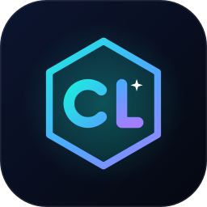
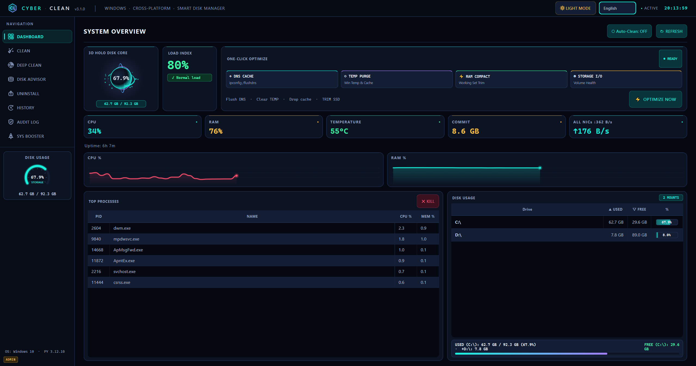
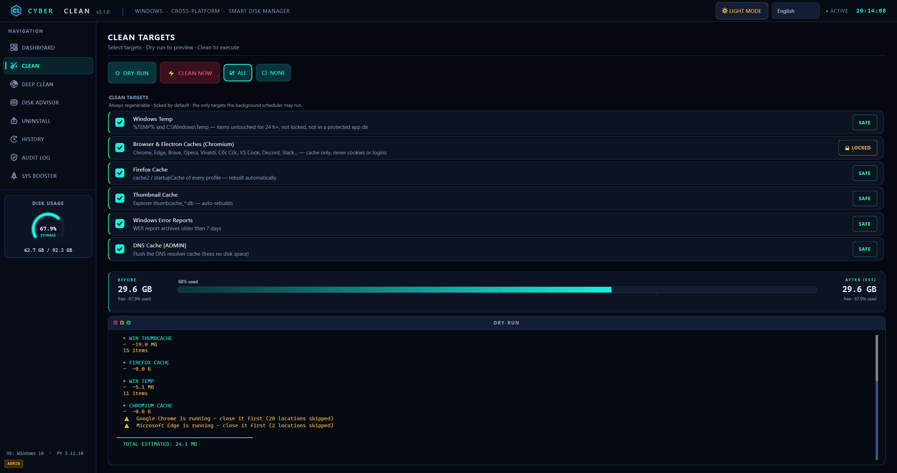
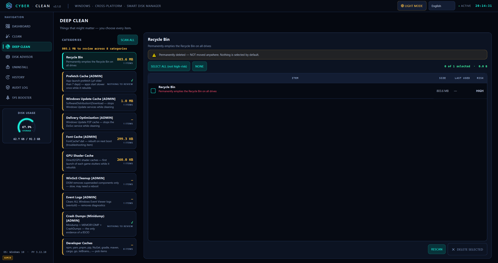
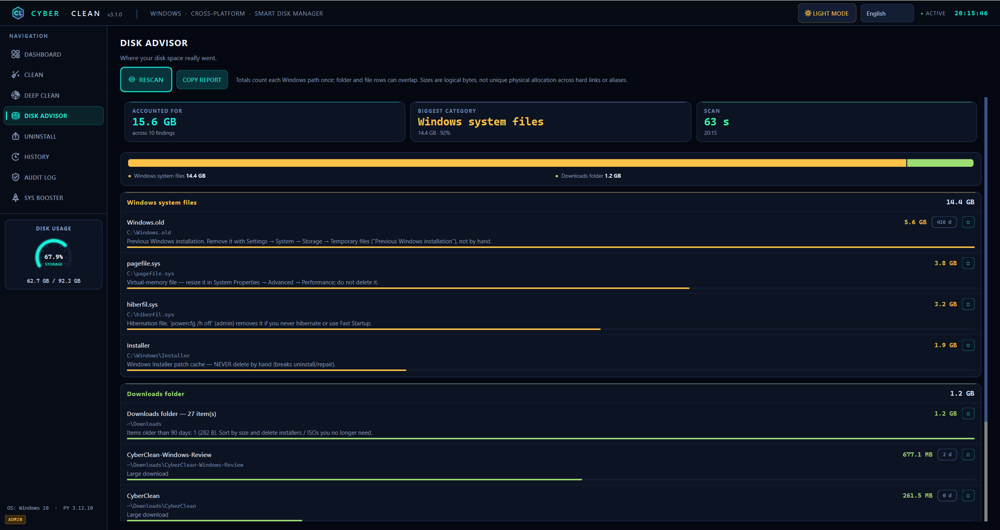
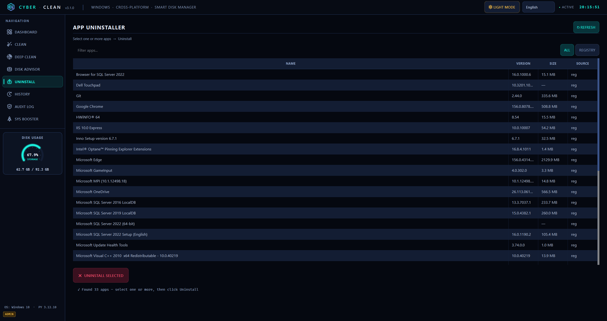
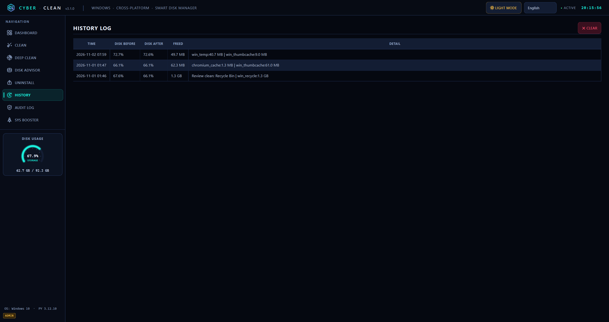
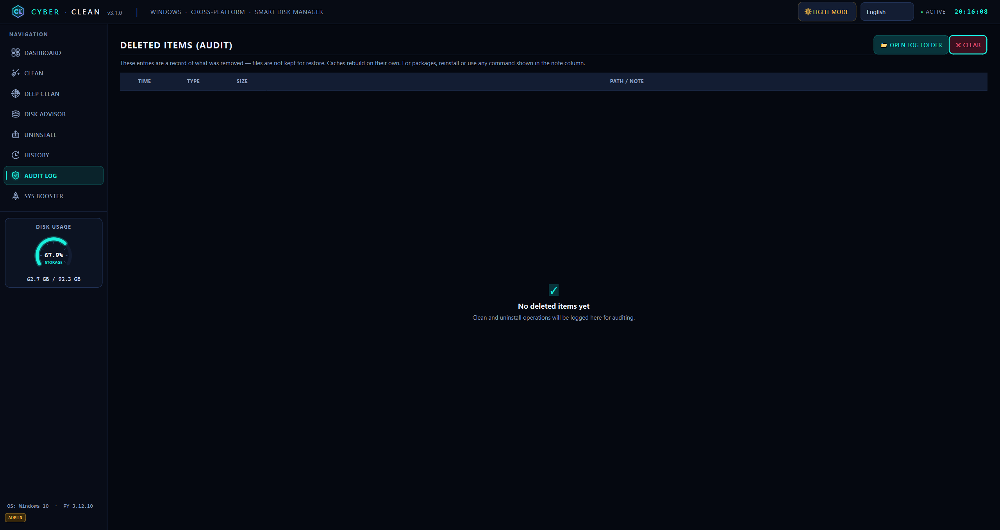
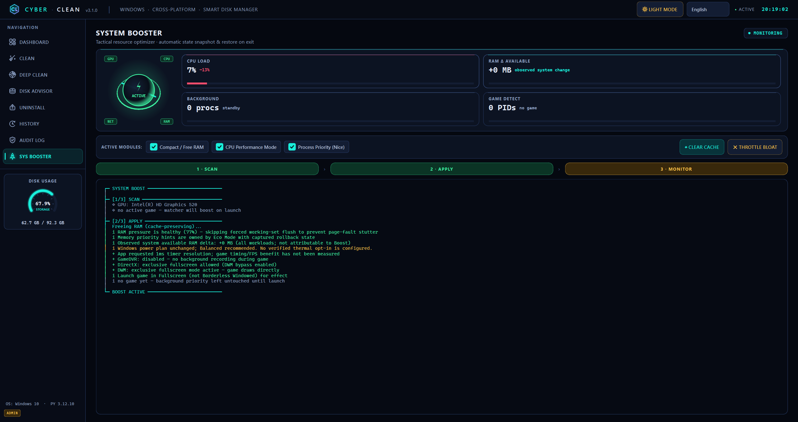

<div align="center">

<!-- Animated Cyber Wave Banner -->




```text
 ██████╗██╗   ██╗██████╗ ███████╗██████╗      ██████╗██╗     ███████╗ █████╗ ███╗   ██╗
██╔════╝╚██╗ ██╔╝██╔══██╗██╔════╝██╔══██╗    ██╔════╝██║     ██╔════╝██╔══██╗████╗  ██║
██║      ╚████╔╝ ██████╔╝█████╗  ██████╔╝    ██║     ██║     █████╗  ███████║██╔██╗ ██║
██║       ╚██╔╝  ██╔══██╗██╔══╝  ██╔══██╗    ██║     ██║     ██╔══╝  ██╔══██║██║╚██╗██║
╚██████╗   ██║   ██████╔╝███████╗██║  ██║    ╚██████╗███████╗███████╗██║  ██║██║ ╚████║
 ╚═════╝   ╚═╝   ╚═════╝ ╚══════╝╚═╝  ╚═╝     ╚═════╝╚══════╝╚══════╝╚═╝  ╚═╝╚═╝  ╚═══╝
```

<!-- Animated Typing SVG (No emojis, pure terminal style) -->
<a href="https://github.com/vuphitung/CyberClean">
  
</a>

**Tiện ích desktop cho Windows và Linux: giám sát hệ thống, dọn dẹp ổ đĩa, báo cáo dung lượng, gỡ ứng dụng và bộ tăng tốc tùy chọn.**

[](https://python.org)
[](https://pypi.org/project/PyQt6/)
[](#hỗ-trợ-nền-tảng)
[](LICENSE)
[](https://github.com/vuphitung/CyberClean/releases/latest)
[](CHANGELOG.md)

<br>

<a href="README.md"></a>&nbsp;&nbsp;<a href="README_vi.md"></a>

</div>


## Cài đặt nhanh (Quick Installation)

<table>
<tr>
<td width="52%" valign="top">

###  &nbsp;Linux

<p>
  
  
  
  
  
</p>

```bash
curl -sSL https://raw.githubusercontent.com/vuphitung/CyberClean/main/install.sh | sudo bash
```
Cài vào `/opt/CyberClean` · đăng ký lệnh `cyberclean` · thiết lập helper đặc quyền có phạm vi giới hạn.

**Gỡ cài đặt:**
```bash
sudo cyberclean --uninstall
```

</td>
<td width="48%" valign="top">

### 

<div align="center">
<br>
<a href="https://github.com/vuphitung/CyberClean/releases/latest">
  
</a>
<br><br>
</div>

**[Tải CyberClean cho Windows (.exe)](https://github.com/vuphitung/CyberClean/releases/latest)**

Chỉ hỏi quyền UAC ở lần cài đầu tiên. Gỡ qua **Settings → Apps → CyberClean**.

</td>
</tr>
</table>


## Giới thiệu

CyberClean hiển thị số liệu hệ thống theo thời gian thực, tìm các tệp có thể dọn, báo cáo dung lượng đã đi đâu, gỡ ứng dụng, và có thể áp dụng một bộ tinh chỉnh hiệu năng có thể hoàn tác khi bạn chơi game hoặc làm việc. Ứng dụng viết bằng PyQt6, có giao diện tối và sáng, ngôn ngữ tiếng Anh và tiếng Việt.

Mục dọn chỉ gồm tệp và cache. CyberClean không phải phần mềm diệt virus và không dọn registry. Hiệu năng phụ thuộc vào máy và khối lượng công việc; ứng dụng không hứa hẹn mức tăng tốc cụ thể.

## Ảnh chụp màn hình

*Windows 10, giao diện tối.*

**Dashboard** — số liệu trực tiếp, bảo trì một chạm, tiến trình nặng nhất, dung lượng từng ổ


**Clean** — cache có thể tạo lại, xem trước (dry-run), ước tính dung lượng giải phóng


**Deep Clean** — từng mục do bạn tự chọn


**Disk Advisor** — dung lượng đã đi đâu (chỉ báo cáo)


**Uninstaller**


**History** và **Audit log**



**System Booster**



## Tính năng

### Dashboard
- CPU, RAM, nhiệt độ (khi có cảm biến), bộ nhớ commit (Windows) hoặc swap (Linux), lưu lượng mạng, biểu đồ lịch sử CPU/RAM và thời gian chạy; làm mới sau vài giây.
- Danh sách tiến trình nặng nhất kèm nút Kill, dung lượng đã dùng/còn trống của từng ổ.
- **Tối ưu một chạm** — Windows: xóa cache DNS, xóa tệp tạm, thu gọn working set, TRIM SSD. Linux: giải phóng cache, chỉnh `vm.swappiness`, `fstrim`, dọn journal cũ.
- *Load index* là chỉ số ước tính từ CPU, RAM, ổ đĩa, nhiệt độ và swap. Đó không phải phần trăm CPU, không phải dữ liệu SMART và không chẩn đoán sức khỏe ổ đĩa.

### Clean
Các mục có thể tự tạo lại, được tích sẵn. *Dry-run* cho xem chính xác những gì sẽ bị xóa trước khi bấm *Clean now*.

| Hệ điều hành | Mục dọn |
|---|---|
| Windows | Windows Temp, cache trình duyệt Chromium và ứng dụng Electron (Chrome, Edge, Brave, Opera, Vivaldi, Cốc Cốc, VS Code, Discord, Slack…), cache Firefox, cache ảnh thu nhỏ, Windows Error Reports, cache DNS |
| Linux | Cache trình quản lý gói (apt, pacman, dnf, zypper, xbps, apk, rpm-ostree), journal và log hệ thống cũ, báo cáo crash, cache trình duyệt và Electron, ảnh thu nhỏ, cache pip, tệp tạm |

Cache trình duyệt được bỏ qua kèm ghi chú nếu trình duyệt đang chạy.

### Deep Clean
Những mục có thể quan trọng. **Không có mục nào được chọn sẵn**, "select all" bỏ qua các dòng rủi ro cao, và mỗi lần xóa đều hỏi xác nhận (mặc định: Cancel). Deep Clean không bao giờ chạy nền.

- Windows: Recycle Bin, Prefetch, cache Windows Update, Delivery Optimization, cache font, cache shader GPU, dọn WinSxS, Event Logs, crash dump, cache lập trình (npm, yarn, pnpm, pip, NuGet, Gradle, Maven, Cargo, Go, JetBrains…).
- Linux: gói mồ côi/không còn dùng (apt, pacman, dnf, xbps), Nix garbage collection, cache lập trình, các thư mục `~/.cache` khác, Thùng rác, và — nếu đã cài — Docker/Podman, runtime Flatpak không dùng, bản cũ của Snap.

### Disk Advisor
Chỉ báo cáo — không có nút xóa. Gom nhóm những nơi chiếm nhiều dung lượng nhất: tệp hệ thống Windows (`Windows.old`, `pagefile.sys`, `hiberfil.sys`, cache Installer), Downloads, tệp lớn, máy ảo và ổ WSL, thư viện game, thư mục `node_modules` / `target` / virtualenv cũ, container, `/opt`, các gói nặng nhất. Có thể mở dòng trong trình quản lý tệp và sao chép báo cáo.

### Uninstaller
- Windows: chương trình đã cài đọc từ Registry, bổ sung thông tin từ `winget`.
- Linux: pacman, apt, dnf, zypper, xbps và Flatpak; các gói lõi của hệ thống được bảo vệ.
- Chọn nhiều ứng dụng, có log tiến trình trực tiếp. Trên Windows danh sách không bị lọc, nên hãy kiểm tra kỹ (driver, runtime) trước khi gỡ.

### History và Audit log
*History* ghi lại dung lượng ổ trước/sau mỗi phiên và dung lượng đã giải phóng. *Audit log* ghi lại những gì đã bị xóa (đường dẫn, loại, kích thước). Cả hai là tệp cục bộ; tệp đã xóa không được giữ để khôi phục.

### System Booster
Áp dụng tinh chỉnh khi bạn yêu cầu và **lưu trạng thái gốc trước**. Trạng thái được khôi phục khi bạn tắt Boost hoặc đóng ứng dụng, và được phục hồi ở lần mở kế tiếp nếu ứng dụng bị tắt đột ngột.

- Windows: yêu cầu độ phân giải timer 1 ms, tắt GameDVR, thiết lập fullscreen DirectX/DWM, ưu tiên cho game được phát hiện, giảm ưu tiên tiến trình nền (EcoQoS trên Windows 11), dọn cache GPU của trình duyệt.
- Linux: CPU governor / power profile, tinh chỉnh bộ nhớ, ưu tiên tiến trình, tùy chọn Hyprland khi đang chạy Hyprland.
- Bộ dò game chỉ nâng ưu tiên khi game đang chạy. Log ghi rõ khi một lợi ích chưa được đo.

### Khay hệ thống và Auto-clean
Auto-clean **tắt theo mặc định**. Khi bật, chỉ chạy các mục `AUTO` được đánh dấu cho phép chạy định kỳ, chỉ khi máy rảnh, tối đa 6 giờ một lần, và chỉ khi ứng dụng đang mở hoặc nằm ở khay. Không bao giờ đụng tới Recycle Bin hoặc Thùng rác. Nếu Auto-clean tắt, đóng cửa sổ là thoát ứng dụng.

### Cập nhật và quyền riêng tư
Ứng dụng kiểm tra GitHub Releases để biết bản mới và không cài gì nếu bạn chưa bấm. Bản tải về được xác minh bằng chữ ký Ed25519 tích hợp trong ứng dụng. Không có telemetry hay analytics; kiểm tra cập nhật là kết nối mạng duy nhất.

## Cách việc dọn dẹp được giữ có kiểm soát

| Tầng | Trang | Hành vi |
|---|---|---|
| `AUTO` | Clean | Cache có thể tạo lại. Tích sẵn. Là tầng duy nhất bộ lập lịch được phép chạy. |
| `REVIEW` | Deep Clean | Mỗi mục phải được chọn rõ ràng. |
| `ADVISOR` | Disk Advisor | Chỉ báo cáo. |

Một lần dọn được **lập kế hoạch, xem trước, rồi mới thực thi**. Ngay trước khi xóa từng mục, engine kiểm tra lại và bỏ qua nếu mục đó đã thay đổi từ lúc quét, đang được dùng, hoặc ứng dụng sở hữu nó đã chạy lại. Symlink và junction không được đi theo, điểm mount không bị vượt qua. **Xóa là vĩnh viễn** — không có gì được chuyển vào Recycle Bin.

## Hỗ trợ nền tảng

| Môi trường | Trạng thái |
|---|---|
| Windows 10 (build 19044), Python 3.12 | Đã chạy và sử dụng trên máy thật: tất cả các trang, đối chiếu số liệu với bộ đếm Windows, nhóm test riêng của Windows đạt. |
| Windows 11 | Có mã xử lý (ví dụ EcoQoS); chưa kiểm chứng trên phần cứng. |
| Linux nền apt (họ Ubuntu / Debian) | Test tự động đạt ở chế độ headless trên Ubuntu với Python 3.12 (628 đạt, 17 bỏ qua). |
| Các bản phân phối Linux khác | Có nhận diện trình quản lý gói pacman, dnf, zypper, xbps, apk, rpm-ostree và Nix; chưa test riêng từng bản. |

Nhiệt độ CPU trên Windows là tùy chọn và cần helper cảm biến đã cài (LibreHardwareMonitor + PawnIO); khi không có cảm biến, dashboard hiển thị `N/A`. Chạy `main.py` trực tiếp từ mã nguồn không kèm helper này.

## Cài đặt

**Yêu cầu:** Python 3.10+ (PyQt6, psutil, cryptography, send2trash; `tomli` trên Python 3.10; `pythonnet` trên Windows). Không cần quyền Administrator/root để mở ứng dụng; các mục gắn `[ADMIN]` cần quyền nâng cao.

### Chạy từ mã nguồn (Windows và Linux)

```bash
git clone https://github.com/vuphitung/CyberClean.git
cd CyberClean
python -m venv .venv

# Linux
source .venv/bin/activate
# Windows PowerShell
.venv\Scripts\Activate.ps1

python -m pip install -r requirements.txt
python -X utf8 main.py
```

### Trình cài đặt Linux (từ bản phát hành đã công bố)

```bash
curl -sSL https://raw.githubusercontent.com/vuphitung/CyberClean/main/install.sh | sudo bash
```

Xác minh chữ ký bản phát hành, cài vào `/opt/CyberClean`, đăng ký lệnh `cyberclean` và mục desktop, đồng thời thiết lập một helper đặc quyền có phạm vi giới hạn. Gỡ cài đặt bằng `sudo cyberclean --uninstall`.

### Gói Windows

Tự build theo phần bên dưới. Gói đã build sẵn được đính kèm trên [GitHub Releases](https://github.com/vuphitung/CyberClean/releases) khi có bản phát hành.

## Build

```bash
python -m pip install pyinstaller
python build.py --linux      # tar.gz cho Linux
python build.py --windows    # thư mục onedir cho Windows trong dist/CyberClean
python build.py --inno       # onedir Windows + script Inno Setup (biên dịch bằng Inno Setup)
```

## Phát triển

```bash
python -m pip install -r requirements-dev.txt
python -m pytest -q
python -m pyflakes main.py ui_widgets.py ui_pages.py core utils
```

Trên Windows, bộ test đầy đủ hiện báo 49 lỗi xuất phát từ các fixture chỉ dành cho POSIX (symlink cần đặc quyền, Unix socket, mục chỉ có trên Linux); nhóm test riêng của Windows đạt. Chi tiết: [báo cáo Windows](docs/WINDOWS_NATIVE_REPORT_VI.md). Hãy dùng thư mục thử riêng khi thử chức năng xóa.

```text
CyberClean/
├── main.py                 # điểm vào, cửa sổ chính và khay hệ thống
├── ui_widgets.py, ui_pages.py
├── core/                   # engine, cleaner, booster, advisor, uninstaller
├── utils/                  # số liệu hệ thống, bản dịch, cập nhật
├── rules/                  # luật dọn theo hệ điều hành (TOML)
├── packaging/              # helper đặc quyền cho Linux
├── vendor/lhm/             # thư viện cảm biến Windows
├── tests/                  # pytest
├── build.py, install.sh
└── assets/, screenshots/
```

## Giới hạn đã biết

- Việc thử tương tác trên máy Linux thật còn hạn chế; vui lòng báo lỗi riêng của từng bản phân phối.
- Windows 11, ARM64 và các tổ hợp DPI/driver khác chưa được kiểm chứng.
- Ứng dụng không đo (benchmark) hiệu quả của Booster.
- Ước tính dung lượng log và WinSxS có thể khác với dung lượng thực sự giải phóng (volume, quyền, snapshot).

## Đóng góp và báo lỗi

Mở issue kèm hệ điều hành và phiên bản, phiên bản CyberClean, các bước bạn đã làm và nội dung hiển thị trong ứng dụng.

## Giấy phép

GNU General Public License v3.0 — see [LICENSE](LICENSE).

